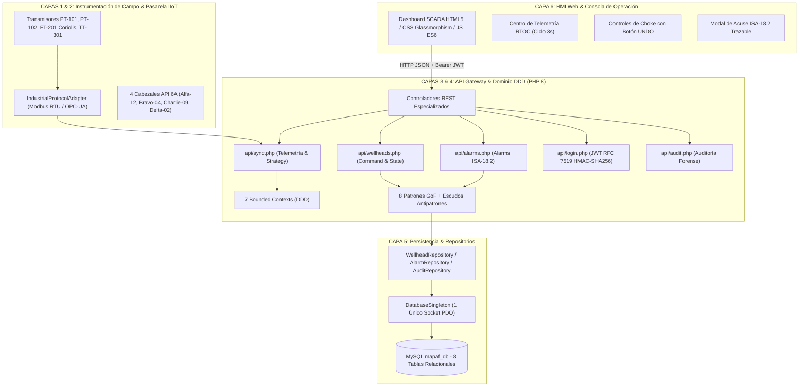

# PROYECTO MAPAF · MANUAL TÉCNICO DE INFRAESTRUCTURA & ARQUITECTURA SCADA

**Sistema de Supervisión, Control y Adquisición de Datos (SCADA) & Telemetría IIoT**  
**SENA · Regional Huila · Centro de la Industria, la Empresa y los Servicios (CIES)**  
**Programa:** Análisis y Desarrollo de Software (ADSO) · **Ficha:** `3413988-ADSO`  
**Instructor:** Javier Humberto Pinto Díaz  
**Integrantes:**  
- Hernann Thomas Manchola Bocanegra  
- María José Conde Dussan  
- Emilin Tatiana Vargas Manchola  

---

## 1. Visión General de la Infraestructura

El proyecto **MAPAF** implementa una arquitectura desacoplada en **6 capas operacionales** alineada con los estándares internacionales de automatización industrial (**ANSI/ISA-95**, **ANSI/ISA-18.2**, **API Spec 6A**, **IEC 61511** y **21 CFR Part 11**), ejecutándose de manera integral sobre el entorno local **XAMPP (Apache + PHP 8 + MySQL)**.

---

## 2. Las 6 Capas de la Infraestructura en Detalle

### Capa 1: Instrumentación de Campo y Actuadores (Field Level)
- **Normas:** `ANSI/ISA-5.1` (Simbología) y `API Spec 6A` (Cabezales y Árboles de Navidad).
- **Instrumentos Activos:**
  - `PT-101`: Transmisor de presión de tubing de pozo (*1,842.5 PSI* nominal).
  - `CASING-101B`: Transmisor de presión anular de casing (*642.0 PSI*).
  - `FT-201`: Medidor de flujo másico Coriolis para fiscalización (*14,820 BPD*).
  - `TT-301`: Sensor de temperatura de manifold (*78.4 °C*).
  - `ESP-01`: Monitor de variador de frecuencia y vibración de bomba (*58.2 Hz*).
  - `GOR-402`: Analizador de relación gas/petróleo (*462.8 SCF/BBL*).
- **Actuadores Físicos:**
  - Válvulas maestras de seguridad de superficie **SSV** (Surface Safety Valve).
  - Válvulas de estrangulamiento **Choke FCV** (Flow Control Valve).
  - Válvulas de purga anular e inyección química de inhibidor de corrosión.

---

### Capa 2: Pasarela de Adquisición & Adaptadores Industriales (Gateway)
- **Patrón de Diseño:** `GoF Adapter` & `Singleton PDO`.
- **Función:** Conectar fuentes de datos de campo y transformarlas al modelo unificado JSON de MAPAF:
  1. Tramas de telemetría y sensores normalizados en base de datos MySQL (`telemetria_metricas`).
  2. Parámetros de proceso (presión tubing, anular, caudal, temperatura, frecuencia ESP, GOR).

---

### Capa 3: API Gateway & Controladores REST (PHP 8 Puro)
Para evitar el antipatrón arquitectónico **The God Object (Blob Monolítico)**, la capa de servicios se encuentra desacoplada en controladores y endpoints REST independientes ubicados en [`controllers/`](file:///c:/Users/MAJO/.antigravity-ide/PROYECTO-MAPAF/controllers/) y [`api/`](file:///c:/Users/MAJO/.antigravity-ide/PROYECTO-MAPAF/api/):

| Endpoint | Método | Controlador | Tabla MySQL | Responsabilidad Específica |
|---|:---:|---|---|---|
| [`api/telemetry.php`](file:///c:/Users/MAJO/.antigravity-ide/PROYECTO-MAPAF/api/telemetry.php) | `GET` | `TelemetryController` | `telemetria_metricas` | Suministro continuo de telemetría y KPIs consolidados de producción. |
| [`api/wellheads.php`](file:///c:/Users/MAJO/.antigravity-ide/PROYECTO-MAPAF/api/wellheads.php) | `POST/GET` | `WellheadController` | `pozos` | Ejecución de maniobras de Choke y SSV con enclavamiento SIS ESD-1. |
| [`api/alarms.php`](file:///c:/Users/MAJO/.antigravity-ide/PROYECTO-MAPAF/api/alarms.php) | `POST/GET` | `AlarmController` | `alarmas` | Ciclo de vida ISA-18.2 y acuse trazable contra acuse ciego (**Blind ACK**). |
| [`api/esd.php`](file:///c:/Users/MAJO/.antigravity-ide/PROYECTO-MAPAF/api/esd.php) | `POST/GET` | `EsdController` | `configuracion_sistema` | Parada de Emergencia ESD-1 (IEC 61511) y rearme seguro de planta. |
| [`api/auth.php`](file:///c:/Users/MAJO/.antigravity-ide/PROYECTO-MAPAF/api/auth.php) | `POST/GET` | `AuthController` | `usuarios`, `roles` | Control de operadores en turno y matriz de permisos RBAC. |
| [`api/audit.php`](file:///c:/Users/MAJO/.antigravity-ide/PROYECTO-MAPAF/api/audit.php) | `GET` | `AuditController` | `bitacora_auditoria` | Consulta de la bitácora electrónica inmutable conforme a 21 CFR Part 11. |
| [`api/status.php`](file:///c:/Users/MAJO/.antigravity-ide/PROYECTO-MAPAF/api/status.php) | `GET` | `StatusController` | Socket MySQL | Diagnóstico en tiempo real de Apache, PHP, conexión PDO y tablas. |

---

### Capa 4: Dominio DDD (7 Bounded Contexts) & Patrones GoF
Contiene las reglas de negocio del SCADA y los algoritmos matemáticos:

1. **Patrón Command (`ScadaCommand.php`):**
   - Encapsula consignas operativas (`SetChokeCommand`, `ToggleSsvValveCommand`, `EmergencyShutdownCommand`).
   - Mantiene una pila de maniobras (`localCommandStack`) y permite la reversión matemática de consignas con el botón **`↺ Deshacer Maniobra (Command UNDO)`**.
2. **Patrón State (`WellheadState.php`):**
   - Máquina de estados finitos bajo `API Spec 6A`: `EN LÍNEA`, `ESTRANGULADO`, `CERRADO` y `DISPARADO (TRIPPED)`.
   - Si un pozo sufre sobrepresión o disparo, activa el enclavamiento `[STATE ACTIVO]` que bloquea la apertura de válvulas hasta que se ejecute el rearme seguro `State::reset()`.
3. **Patrón Strategy (`FlowCalculationStrategy.php`):**
   - Algoritmos polimórficos de fiscalización intercambiables en vivo:
     * `AGA-11 / Coriolis`: Medición fiscal másica directa (Incertidumbre ±0.15%).
     * `AGA-3`: Placa de orificio por presión diferencial (Incertidumbre ±1.25%).
     * `Beggs & Brill`: Simulación multifásica hidrodinámica (Crudo/Gas/Agua).
4. **Patrón Observer (`TelemetryObserver.php`):**
   - Al sobrepasar límites críticos, el sensor (`TelemetrySubject`) notifica en paralelo a 3 observadores desacoplados:
     * `AlarmTriggerObserver`: Genera la alarma bajo norma ISA-18.2.
     * `SafetyInterlockObserver`: Ordena el aislamiento del cabezal ESD-1.
     * `AuditLoggerObserver`: Graba la transgresión inmutable en MySQL.
5. **Patrón Factory Method (`SensorFactory.php` & `AlarmFactory.php`):**
   - Instanciación tipada de sensores con umbrales calibrados según magnitud física.

---

### Capa 5: Persistencia & Repositorios (MySQL `mapaf_db`)
- **Conexión Eficiente:** [`DatabaseSingleton.php`](file:///c:/Users/MAJO/.antigravity-ide/PROYECTO-MAPAF/backend_php/patterns/Singleton/DatabaseSingleton.php) mantiene una única instancia de conexión PDO, impidiendo que peticiones concurrentes agoten el pool de conexiones en XAMPP.
- **Seguridad contra SQL Injection:** Consultas parametrizadas estrictas (`Prepared Statements`) implementadas en los repositorios de dominio:
  - `WellheadRepository`: Consultas y mutaciones de cabezales y estranguladores.
  - `AlarmRepository`: Registro, shelving y acuse seguro de alarmas.
  - `AuditRepository`: Inserción inmutable append-only con usuario y hora.

---

### Capa 6: HMI Web & Consola Operacional (Presentation Layer)
- **Tecnología:** HTML5 semántico, CSS3 moderno con Glassmorphism (tema oscuro industrial de alto contraste) y JavaScript ES6 sin dependencias externas pesadas.
- **Características Operacionales:**
  - Ciclo de refresco reactivo automático cada 3 segundos sin parpadeo.
  - Conmutador dinámico de roles de operador con tokens JWT en tiempo real.
  - Sliders de estrangulador con feedback instantáneo y rollback en 1 clic.
  - Indicador contextual en barra superior del Bounded Context activo (`[TELEMETRY-CTX]`, `[WELLHEAD-CTX]`, etc.).

---

## 3. Matriz de Puertos, Servicios y Enlaces en XAMPP

| Servicio | Puerto Local | Proceso / Binario | Ruta en el Sistema |
|---|:---:|---|---|
| **Servidor Web Apache** | `80 (HTTP)` | `httpd.exe` | `C:\xampp\apache\bin\httpd.exe` |
| **Base de Datos MySQL** | `3306 (TCP)` | `mysqld.exe` | `C:\xampp\mysql\bin\mysqld.exe` |
| **Directorio de Publicación** | — | Enlace Simbólico (`Junction`) | `C:\xampp\htdocs\mapaf` ➔ `c:\Users\MAJO\.antigravity-ide\PROYECTO-MAPAF\backend_php` |
| **Consola phpMyAdmin** | `80` | Script Web PHP | `http://localhost/phpmyadmin/index.php?route=/database/structure&db=mapaf_db` |

---

## 4. Guía Rápida para el Evaluador / Instructor SENA

1. **Abrir la plataforma principal:**  
   Navega a [http://localhost/mapaf/](http://localhost/mapaf/)
2. **Consultar la nueva pestaña de Infraestructura:**  
   Haz clic en el botón superior **`🏗️ Infraestructura (6 Capas)`** o abre el módulo **"10. Infraestructura & Topología SCADA"**.
3. **Probar el Simulador de Flujo E2E:**  
   Haz clic en los botones de trazabilidad:
   - `[▶ 1. Maniobra Choke con UNDO]`
   - `[▶ 2. Disparo de Alarma y Acuse Trazable]`
   - `[▶ 3. Autenticación Criptográfica JWT]`
   - `[▶ 4. Parada de Emergencia ESD-1]`  
   Observarás en pantalla la descripción exacta de cómo la petición atraviesa cada una de las 6 capas.
4. **Verificar el monitor de salud en vivo:**  
   Pulsa el botón **`⚡ Test de Latencia & Salud`** para medir el ping real de ida y vuelta hacia el backend PHP y MySQL.
